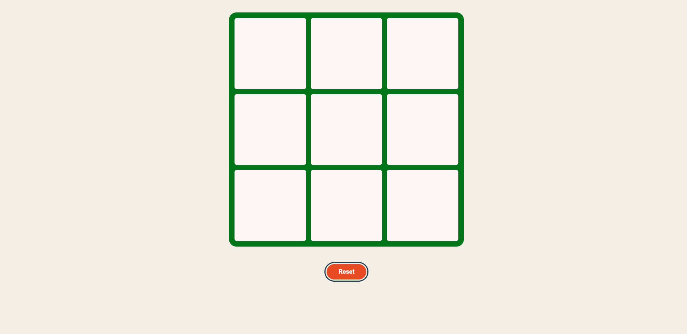
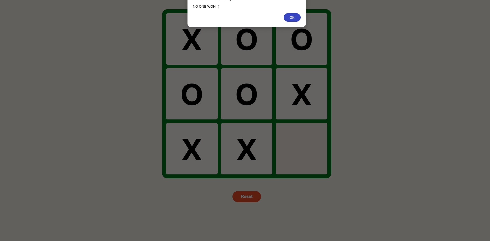

# Tic Tac Toe

Two-player Tic Tac Toe game for the browser. Players take turns placing X and O on a 3x3 board, and the game announces a win or a draw. Built with plain HTML, CSS and JavaScript.

[Visit Tic-Tac-Toe](https://malcolmcpu.github.io/tic-tac-toe/)

## Preview




## 🛠️ Built with

- **HTML5**: the board is a container holding nine `.square` elements, plus a Reset button
- **CSS3**: CSS Grid for the 3x3 board, Flexbox for centering, and thick green grid lines
- **Vanilla JavaScript**: DOM event listeners, array methods and simple game logic

## How it works

1. Player **X** always goes first. Click any empty square to place a mark.
2. Each click puts the current player's mark in the square. Clicking a square that's already taken does nothing.
3. After every move, the game checks whether the current player has a winning line and whether the board is full.
4. If someone wins, or the board fills up with no winner, an alert announces the result.
5. The turn then switches between X and O.
6. Click **Reset** to clear the board. X goes first again.

## 📚 What I learned

- Selecting elements with `querySelectorAll` and turning the result into an array with `Array.from`
- Adding click listeners to a whole group of elements with `forEach`
- Using a ternary operator to switch turns between two players
- Checking a board state with `&&`, `||` and the array method `every`
- Building a grid layout with CSS Grid and `box-sizing: border-box`

## Run It Locally

1. Clone the repo:

```bash
git clone https://github.com/malcolmcpu/tic-tac-toe.git
```

2. Open the project folder.
3. Open `index.html` in your web browser.
   That's it. There's nothing to install.
